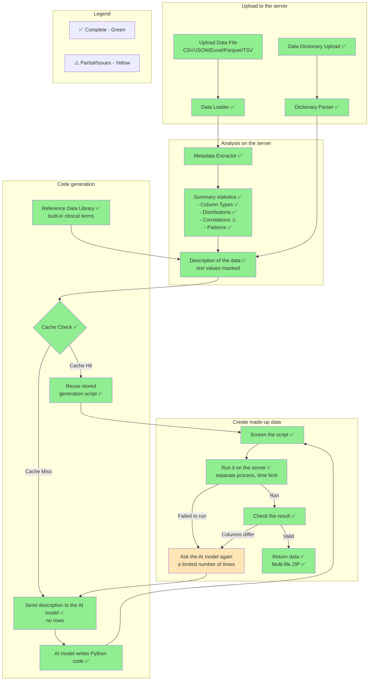

# BYOD Synthetic Data Generator - Architecture Flow

## How It Works

## What is sent to the AI model

**Rows are never sent to the AI model. A description of the data is.**

Your file is sent to the server and analysed there. This release has not been approved for real study data or patient identifiers.

1. **Building the description** (`src/core/metadata_extractor.py`, on the server):
   - Column names and data types. Column names are always sent as they are.
   - Counts and summary statistics (mean, spread, range).
   - Correlations between columns.
   - Value patterns (date formats, ID shapes such as `MRN-<7 digits>`).
   - Text values are replaced with placeholders, except repeated short category labels in Balanced and Permissive modes.
   - Ordinary number columns send their real smallest, largest, middle and quartile values in Balanced and Permissive modes when the column has 20 or more values. Strict mode and smaller columns send rounded numbers and a widened range. Identifier-like columns (`patient_id`, `mrn`, `zip`, ...) send none of these.
   - Date ranges are widened to whole months or whole years. Exact earliest and latest dates are not sent.

2. **AI model**: An Azure OpenAI model hosted by the organisation receives the description (and the content of a data dictionary, if one was uploaded) and writes Python code. A request may choose the model from the server's allow-list.

3. **Running the code**: The code is screened (only data libraries; no file, network or process access) and then runs as a separate process on the same server as the application. This is a screen, not full isolation.

4. **Storage**: The description and the generated script are saved in the cache on the server's disk. The uploaded file is not written to the cache; the web framework may keep it in a temporary file while a request is processed.

If the AI model is unavailable, generation fails with a clear error. There is no other generator.

## Column Type Detection

The system detects column types through:
- Pandas dtype inference
- Enhanced pattern matching:
  - ID patterns with prefixes (C001, INV-2024)
  - Email addresses with domain validation
  - Phone numbers with format preservation
  - Datetime patterns including timestamps
  - Currency values with proper decimals
- Statistical analysis (numeric distributions)
- Categorical detection with safety modes:
  - Strict: no text value is sent to the AI model
  - Balanced: repeated short category labels, up to 10 distinct values
  - Permissive: the same rule, up to 50 distinct values

## Caching Mechanism

When you upload a file:
1. A hash is created from the metadata structure
2. Similar metadata patterns are searched in the cache
3. If found (based on match threshold), existing generation code is reused
4. A stored script is reused only for the number of rows it was written for. A stored script that fails to run is dropped

## Known Limitations

- **Complex Relationships**: Multi-column dependencies may not be fully preserved
- **Large Files**: The whole file is read into memory; uploads are limited to 50 MB by default
- **No sign-in**: anyone who can reach the site on the organisation network (VPN) can use it
- **Batch generation**: switched off in this release
