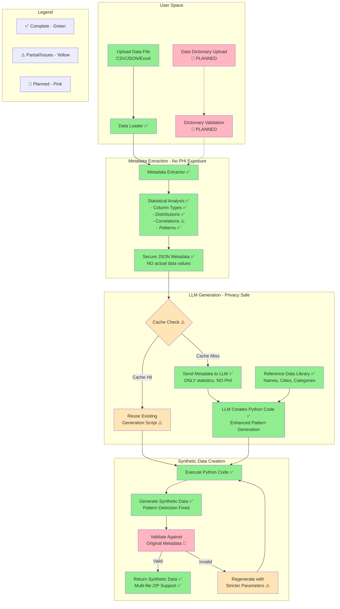

# BYOD Synthetic Data Generator - Architecture Flow

## How It Works

## Privacy Protection

**THE LLM NEVER SEES YOUR ACTUAL DATA**

1. **Metadata Extraction**: Analyzes your data locally to extract only statistical properties:
   - Column names and data types
   - Statistical distributions (mean, std, min, max)
   - Correlation patterns between columns
   - Value patterns (e.g., date formats, string patterns)
   - NO actual data values are extracted

2. **LLM Role**: The LLM receives only the metadata and creates Python code to generate synthetic data that matches the statistical properties. It never sees any actual data values.

3. **Synthetic Generation**: The Python code runs locally to create new synthetic data matching the patterns.

## Column Type Detection

The system detects column types through:
- Pandas dtype inference
- Enhanced pattern matching:
  - ID patterns with prefixes (C001, INV-2024)
  - Email addresses with domain validation
  - Phone numbers with format preservation
  - Datetime patterns including timestamps
  - Currency values with proper decimals
- Statistical analysis (numeric distributions)
- Smart categorical detection with safety modes:
  - Strict: Maximum privacy
  - Balanced: Preserves common non-sensitive categories
  - Permissive: Maximum realism

## Caching Mechanism

When you upload a file:
1. A hash is created from the metadata structure
2. Similar metadata patterns are searched in the cache
3. If found (based on match threshold), existing generation code is reused
4. This ensures consistent results for similar data structures

## Known Limitations

- **Complex Relationships**: Multi-column dependencies may not be fully preserved
- **Large Files**: Memory-based processing (streaming support planned)

## Recent Improvements (September 2025)

- ✅ Enhanced pattern detection for common data types
- ✅ Smart categorical value preservation with safety modes
- ✅ Reference data library for realistic value generation
- ✅ Currency and datetime format detection

## Future Improvements

- Domain-specific medical value lists (medications, diagnoses)
- Multi-column relationship preservation
- Streaming support for large files